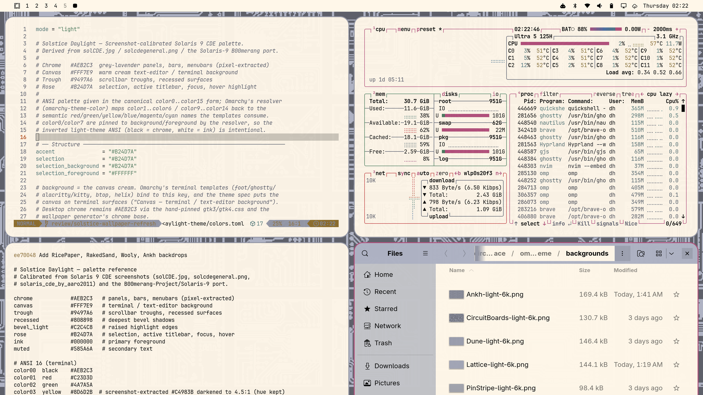
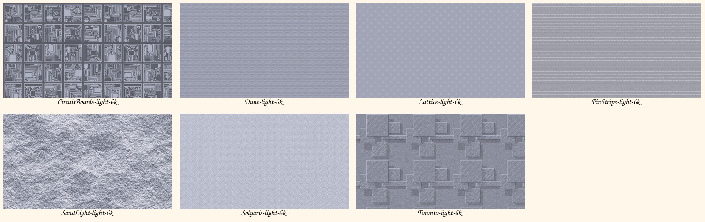

# Solstice Daylight for Omarchy

A Solaris CDE-inspired light theme with grey-lavender chrome, a warm cream
canvas, and rose accents.



## Install

```sh
omarchy theme install https://github.com/circumspace/omarchy-solstice-daylight-theme
```

## Backgrounds

Fourteen CDE-inspired wallpapers are included. Cycle through them with
`omarchy theme bg next`.



The 6K backdrops are generated from
[NsCDE](https://github.com/NsCDE/NsCDE) XPM tile patterns and recolored to the
Solstice Daylight palette.

## Palette

| Role | Color |
| --- | --- |
| Background | `#FFF7E9` |
| Foreground | `#000000` |
| Chrome | `#AEB2C3` |
| Accent | `#B24D7A` |
| Recessed surface | `#9497A6` |

Omarchy generates terminal, editor, and application themes from
[`colors.toml`](colors.toml).

## CDE details

The theme includes sharp-cornered GTK 3/4 styling and a matching Chromium frame
tint. GTK loads user CSS at startup, so restart GTK applications after switching
into or out of this theme.

Detailed color values and their provenance are documented in
[`palette.txt`](palette.txt).

## Solstice family

- [Solstice Nightwatch](https://github.com/circumspace/omarchy-solstice-nightwatch-theme)
  — dark violet and rose
- [Solstice Crimson](https://github.com/circumspace/omarchy-solstice-crimson-theme)
  — original Solaris CDE Crimson4 palette

## Credits

- Solaris 9 CDE desktop captures
- [B00merang Project's Solaris 9 theme](https://github.com/B00merang-Project/Solaris-9)
- [NsCDE](https://github.com/NsCDE/NsCDE)

## License

MIT — see [LICENSE](LICENSE).